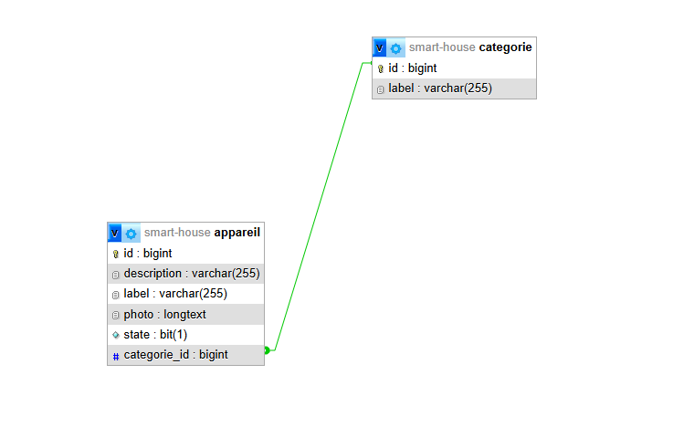
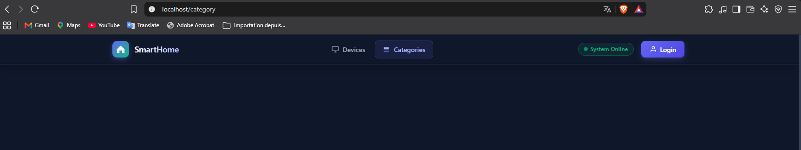
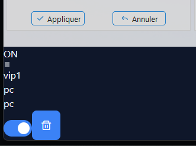
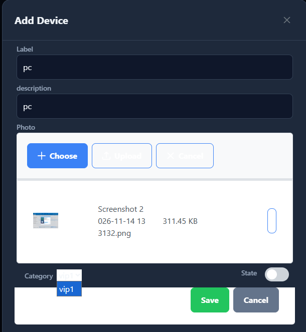
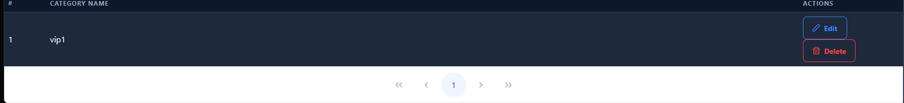
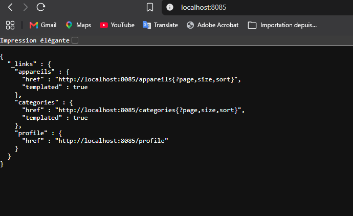
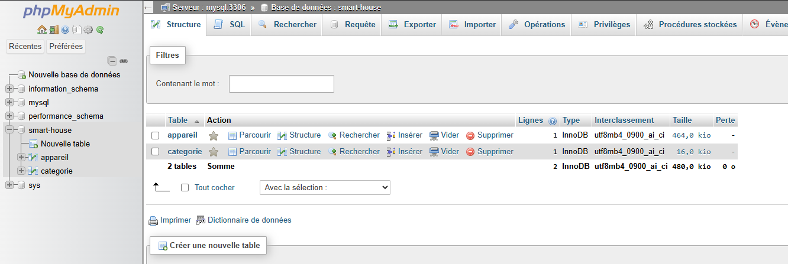

# 🏠 Smart Home - Application de Gestion Domotique Conteneurisée

Projet complet de conteneurisation d'une application Full-Stack **Spring Boot** & **Angular** connectée à une base de données **MySQL**, orchestrée avec **Docker Compose**.

---

## 📌 Présentation du Projet

Cette application permet de gérer et surveiller les appareils connectés d'une maison intelligente :
- Consultation et contrôle de l'état des appareils connectés (ON / OFF individuel ou global).
- Ajout, modification et suppression d'appareils avec photos et descriptions.
- Gestion des catégories d'équipements domotiques.
- Interface moderne, réactive et intuitive.

---

## 🏗️ Architecture & Conteneurisation

L'ensemble de l'écosystème est isolé et conteneurisé grâce à Docker et Docker Compose.



### Services Déployés :
1. **Frontend (`frontend`)** : Application Angular compilée en multi-stage build et servie par un serveur Web **Nginx** (Port `80`).
2. **Backend (`backend`)** : API REST développée avec **Spring Boot** (Java 17), packagée via Maven multi-stage build (Port `8085`).
3. **Database (`mysql`)** : Base de données relationnelle **MySQL** avec initialisation automatique du schéma `smart-house` (Port `3306`).
4. **Administration DB (`phpmyadmin`)** : Interface web d'administration de la base MySQL (Port `8081`).

---

## 🛠️ Technologies Utilisées

- **Frontend** : Angular, TypeScript, PrimeNG, TailwindCSS, Nginx
- **Backend** : Spring Boot, Spring Data JPA, Java 17, Maven
- **Base de données** : MySQL, phpMyAdmin
- **DevOps / Conteneurisation** : Docker, Docker Compose, Multi-stage builds

---

## 🚀 Démarrage Rapide

### Prérequis
- [Docker Desktop](https://www.docker.com/products/docker-desktop/) installé et en cours d'exécution.
- S'assurer que les ports `80`, `8081`, `8085` et `3306` sont libres (arrêter les instances locales de MySQL ou serveurs web tels que Apache/XAMPP).

### 1. Cloner le projet
```bash
git clone https://github.com/fati24la/Tp24-ConteneurisationSpringAngular.git
cd Tp24-ConteneurisationSpringAngular
```

### 2. Lancer les conteneurs
Exécutez la commande suivante à la racine du projet pour builder et démarrer tous les conteneurs :
```bash
docker compose up --build
```

> 💡 *Au premier lancement, le téléchargement des images de base et la compilation peuvent prendre quelques minutes.*

### 3. Accès aux applications

| Service | URL d'accès | Description |
| :--- | :--- | :--- |
| **Frontend (Angular)** | [http://localhost](http://localhost) | Interface utilisateur principale |
| **Backend (Spring Boot API)** | [http://localhost:8085](http://localhost:8085) | Endpoints REST |
| **phpMyAdmin** | [http://localhost:8081](http://localhost:8081) | Gestion de la base de données |
| **MySQL Database** | `localhost:3306` | Serveur de base de données |

#### 🔑 Identifiants MySQL & phpMyAdmin
- **Serveur** : `mysql`
- **Utilisateur** : `root`
- **Mot de passe** : `root`
- **Base de données** : `smart-house`

---

## 📸 Aperçu & Captures d'Écran

### 1. Page d'Accueil & Tableau de Bord


---

### 2. Liste & État des Appareils (Devices)
Contrôle en direct des appareils connectés (interrupteurs ON/OFF, suppression, visualisation par catégorie).


---

### 3. Ajout d'un Nouvel Appareil
Formulaire d'ajout avec upload d'image, assignation de catégorie et configuration de l'état initial.


---

### 4. Gestion des Catégories
Visualisation, création, modification et suppression des catégories d'équipements.


---

### 5. Backend Spring Boot & API
Vérification du démarrage et de la connectivité de l'API REST.


---

### 6. Base de Données (phpMyAdmin / Données)
Données stockées dans les tables MySQL (`appareil`, `categorie`).


---

## 🛑 Arrêter le Projet

Pour stopper l'ensemble des conteneurs :
```bash
docker compose down
```

Pour stopper et supprimer également les volumes associés (réinitialisation complète) :
```bash
docker compose down -v
```
